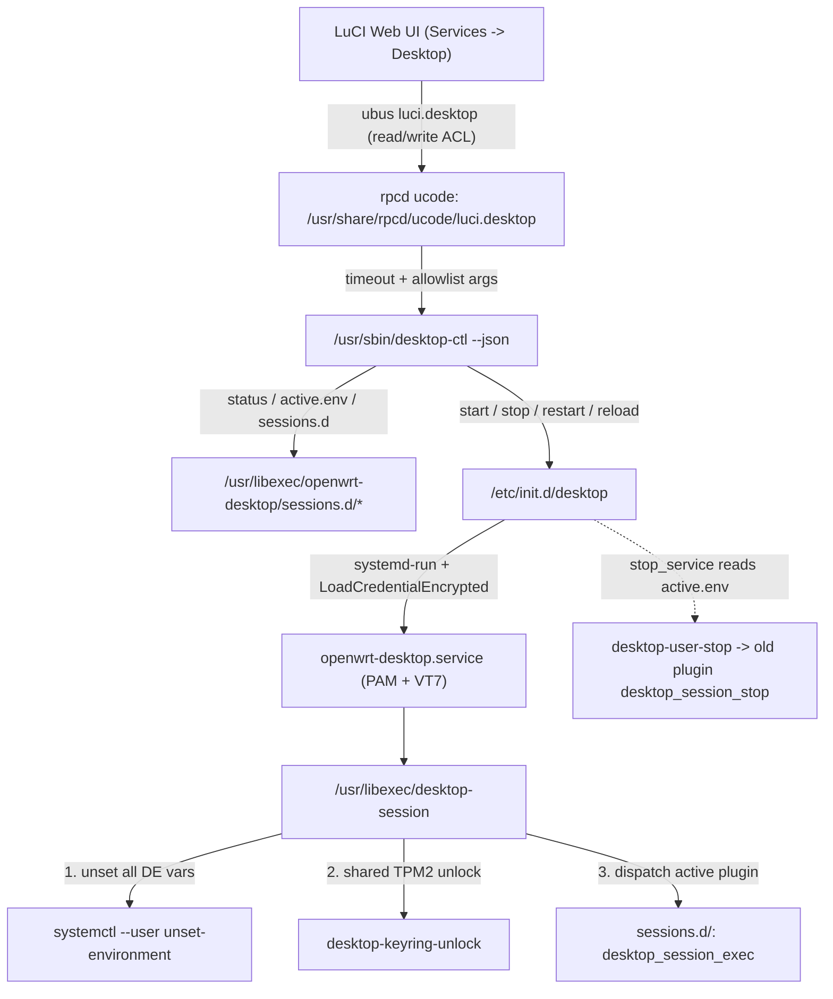

# 可插拔桌面会话切换层与 LuCI 控制面板实施计划

**实施状态：主机侧代码、测试、包编译与文档已完成（2026-11-23），待 VM / 实机运行时验证。** 详见 [功能说明](desktop-session-switcher.md) 与 [验证记录](desktop-session-switcher-validation.md)。

本文档记录在不引入 GDM、完全保留现有 TPM2 无人值守 keyring 解锁与 PAM/logind/VT7 启动链的前提下，为 `openwrt-desktop` 引入可插拔桌面会话切换层（`sessions.d/` + `desktop-ctl`）并配套 `luci-app-desktop` Web 控制面板的设计与实施计划。

现有 GNOME 桌面架构见 [GNOME 桌面文档](gnome-desktop.md)。

---

## 1. 背景与目标

### 1.1 为何不采用 GDM 切换桌面
当前桌面采用 Root-only 预置的无人值守解锁方案：
- `desktop-setup` 为新建用户生成 96 字符随机密码的 `login.keyring`，并用 TPM2 SRK 封存至 `/etc/desktop/gnome/<UID>.keyring-passphrase.cred`（无 TPM2 时回退至明文文件）。
- `desktop.init` 通过 `systemd-run` 注入 `LoadCredentialEncrypted=keyring-passphrase:...`，由 `desktop-session` 调用 `desktop-keyring-unlock` → `desktop-keyring-control-unlock` 直接向 `$XDG_RUNTIME_DIR/keyring/control` 解锁。
- 若移植 GDM，GDM 密码登录通过 `pam_gnome_keyring.so` 传递用户 Linux 登录密码，与随机 bootstrap 密码冲突；同时 GDM 会绕过 `desktop.init` / `LoadCredentialEncrypted` 启动链，影响无人值守解锁与当前共享会话模式下的 LAN RDP / Sunshine。

### 1.2 本计划目标
在**尚无 KDE Plasma（或其他第二个 DE）**的当前阶段，先完成以下两项基础设施：
1. **后端可插拔会话抽象层（`package/custom/openwrt-desktop`）**：
   - 在 `/etc/config/desktop` 引入 `option session 'gnome'`（缺省回退 `gnome`，完全向后兼容）。
   - 引入会话插件目录 `/usr/libexec/openwrt-desktop/sessions.d/`，将当前硬编码在 `desktop.init`、`desktop-session`、`desktop-user-stop` 中的 GNOME 逻辑抽离为首个插件 `sessions.d/gnome`。
   - 运行时原子写入 `/run/openwrt-desktop/active.env`，记录实际运行中的 `session`、`user`、`kms_scheduling`、`output`、`mode`，确保切换 DE 时按**旧会话**优雅停止、清理跨 DE 的 `systemctl --user` 残留环境变量，再启动**新会话**。
   - 新增结构化根权限控制 CLI `/usr/sbin/desktop-ctl`，供命令行与 LuCI 复用。
2. **LuCI Web 控制面板（新建 `package/custom/luci-app-desktop`）**：
   - 提供实时状态总览（服务状态、当前 DE、配置漂移提示、keyring 凭据类型与解锁状态、LAN 地址、RDP/Sunshine/音频状态）、启停/重启/一键切换、UCI 参数配置及 `openwrt-desktop.service` 日志查看。
   - 通过 `rpcd` ucode 模块 (`luci.desktop`) + 读写分离 ACL 严格白名单调用 `/usr/sbin/desktop-ctl`，不暴露凭据、密码或账号管理。
   - 未来移植 KDE Plasma（或 Sway 等）时，新包只需提供 `/usr/libexec/openwrt-desktop/sessions.d/plasma`，主调度器和 LuCI 自动发现，无需修改核心代码。



---

## 2. 关键设计边界与待确认项

### 2.1 设计边界
1. **LuCI 安全边界与只读字段**：
   - `user`（依赖 `desktop-setup` 生成 TPM2 `.cred`/TLS/用户组）、`rdp_port`（需 `desktop-rdp-setup` 写入 `grdctl`）、`sunshine_capture`（`kms` 模式需 `sunshine-setup` 授予/撤销二进制 `cap_sys_admin`）**无法仅靠改 UCI 正确生效**。
   - 因此在 LuCI 中将这三个字段设为**只读状态展示**并附 SSH 命令行提示；仅把改 UCI 即可安全生效的字段（`enabled`、`session`、`output`、`mode`、`kms_scheduling`、`rdp_enabled`）设为可编辑。
   - LuCI 永不读取或展示 `/etc/desktop/gnome/*` 凭据内容，也不提供创建用户或设置密码功能。
2. **`reload` 与 `restart` 职责分离**：
   - 现有 `desktop.init` 的 UCI trigger 仅触发 `reload_service`（刷新 `/run/openwrt-desktop/<UID>.env`，用于热开关 `rdp_enabled` 和响应 LAN IP 变化，不中断桌面）。
   - 修改 `session`、`kms_scheduling`、`output`、`mode` 后，LuCI 状态区展示“配置已变更，需重启桌面生效”横幅并提供带确认弹窗的 **Restart Desktop** 按钮（同时提供显式 **Switch & Restart** 操作），避免误操作强杀正在使用的图形窗口与远程连接。
3. **暂不拆分 `openwrt-desktop-core` 包与用户态目标**：
   - 在尚无第二个 DE 之前，先在 `openwrt-desktop-core` 内部完成 `sessions.d/` 抽象，避免无谓的 APK 拆包迁移；待未来移植 KDE 时再拆为 `openwrt-desktop-base` + `openwrt-desktop-gnome` + `openwrt-desktop-plasma`。
   - `openwrt-fcitx5.service`、`openwrt-audio-session.target`、`sunshine.service` 暂保持绑定 `gnome-session.target` 以确保 GNOME 零回归；未来接入 KDE 时再迁移至 `graphical-session.target`，并关闭 KWallet 的 Secret Service 后端以复用 TPM2 自动解锁的 `gnome-keyring-daemon`。

### 2.2 已与用户确认的决策
1. **LuCI 菜单位置**：放在 `Services -> Desktop`（`admin/services/desktop`，order 62，与 `daed` / `podman` / `qemu` 并列）。
2. **修改 `session` 后的重启行为**：`Save & Apply` 仅保存配置，不自动强杀正在运行的桌面窗口；配置变更后页面立即弹出“配置已变更，需重启桌面生效”横幅并提供带确认弹窗的重启按钮，同时在会话处提供单独的 `Switch & Restart` 一键切换按钮。
3. **默认构建配置**：同步将 `CONFIG_PACKAGE_luci-app-desktop=y` 加入 `configs/gnome-desktop.config` 和当前 `.config`。

---

## 3. 实施方案

### 3.1 `package/custom/openwrt-desktop`（可插拔会话层与 `desktop-ctl`）

- **`package/custom/openwrt-desktop/Makefile`**：
  - `PKG_RELEASE` 从 `38` 递增至 `39`（满足 APK 不可变包标识规则）。
  - 在 `Package/openwrt-desktop-core/install` 中安装 `/usr/libexec/openwrt-desktop/sessions.d/gnome`（`0644`）与 `/usr/sbin/desktop-ctl`（`0755`）。

- **`package/custom/openwrt-desktop/files/desktop.config`**：
  - 在 `config desktop 'main'` 下新增 `option session 'gnome'`。

- **新增 `package/custom/openwrt-desktop/files/sessions.d/gnome`**：
  定义统一的会话插件契约（静态 `SESSION_*` 元数据 + 3 个 POSIX shell 函数）：
  ```sh
  SESSION_ID="gnome"
  SESSION_TITLE="GNOME (Wayland)"
  SESSION_DESCRIPTION="GNOME 51 Wayland desktop with Mutter"
  SESSION_EXEC="/usr/bin/gnome-session"
  SESSION_SUPPORTS_RDP="1"
  SESSION_SUPPORTS_KMS_SCHEDULING="1"
  SESSION_UNSET_VARS="MUTTER_DEBUG_KMS_SCHEDULING_PRIORITY"

  desktop_session_check() {
    [ -x "$SESSION_EXEC" ]
  }

  desktop_session_exec() {
    export XDG_CURRENT_DESKTOP=GNOME XDG_SESSION_DESKTOP=gnome DESKTOP_SESSION=gnome
    export XDG_SESSION_TYPE=wayland XMODIFIERS=@im=fcitx QT_IM_MODULE=fcitx
    export XDG_DATA_DIRS="$HOME/.local/share/flatpak/exports/share:/var/lib/flatpak/exports/share:${XDG_DATA_DIRS:-/usr/local/share:/usr/share}"
    import_kms=
    case "${OPENWRT_DESKTOP_KMS_SCHEDULING:-high-priority}" in
      realtime|normal)
        export MUTTER_DEBUG_KMS_SCHEDULING_PRIORITY="$OPENWRT_DESKTOP_KMS_SCHEDULING"
        import_kms=MUTTER_DEBUG_KMS_SCHEDULING_PRIORITY
        ;;
    esac
    systemctl --user import-environment \
      XDG_CURRENT_DESKTOP XDG_SESSION_DESKTOP DESKTOP_SESSION \
      XDG_SESSION_TYPE XMODIFIERS XDG_DATA_DIRS QT_IM_MODULE $import_kms
    exec "$SESSION_EXEC" --session=gnome
  }

  desktop_session_stop() {
    exec systemctl --user start gnome-session-shutdown.target
  }
  ```

- **`package/custom/openwrt-desktop/files/desktop-common.sh`**：
  - 新增固定常量 `DESKTOP_SESSIONS_DIR=/usr/libexec/openwrt-desktop/sessions.d`（不从外部环境变量读取，防止特权脚本被注入路径）。
  - 新增 `desktop_validate_session_id`（`^[a-z0-9][a-z0-9_-]*$`，上限 32 字符）、`desktop_session_plugin_path`（校验常规文件、非软链、属主 root）、`desktop_load_session`、`desktop_collect_unset_vars`（汇总基础变量与所有已安装插件声明的 `SESSION_UNSET_VARS`）。

- **`package/custom/openwrt-desktop/files/desktop.init`**：
  - `start_service()` 读取 `session`（默认 `gnome`）、`mode`、`output`，调用 `desktop_load_session` 与 `desktop_session_check`，向 `systemd-run` 传入 `--setenv=OPENWRT_DESKTOP_SESSION="$session"`，并在启动成功后原子写入 `/run/openwrt-desktop/active.env`（`ACTIVE_SESSION`、`ACTIVE_USER`、`ACTIVE_KMS_SCHEDULING`、`ACTIVE_OUTPUT`、`ACTIVE_MODE`）。
  - `stop_service()` 优先从 `/run/openwrt-desktop/active.env` 读取 `ACTIVE_SESSION` 与 `ACTIVE_USER`（缺失时回退 UCI），确保切换 DE 时用旧会话停止脚本关闭旧 DE，停止单元并清理 `/run/openwrt-desktop/active.env`。

- **`package/custom/openwrt-desktop/files/desktop-session`**：
  - 读取 `OPENWRT_DESKTOP_SESSION`（默认 `gnome`）并加载对应插件。
  - 等待 `$XDG_RUNTIME_DIR/bus` 就绪后，一次性清理通用变量 + 所有插件的 `SESSION_UNSET_VARS`（本地 `unset` + 单次 `systemctl --user unset-environment`）。
  - 保持 `/usr/libexec/desktop-keyring-unlock`、`cd "$HOME"`、`/usr/libexec/desktop-user-setup --xdg-dirs` 不变，最后调用插件 `desktop_session_exec`。

- **`package/custom/openwrt-desktop/files/desktop-user-stop`**：
  - 接收会话 ID（参数 `$1` 或 `OPENWRT_DESKTOP_SESSION`，默认 `gnome`），加载对应插件并调用 `desktop_session_stop`；插件不存在时安全返回 0。

- **`package/custom/openwrt-desktop/files/desktop-setup`**：
  - 检查已配置的会话插件（默认 `gnome`）可用，而非写死 `/usr/bin/gnome-session`；若 UCI 未设置 `desktop.main.session`，初始化为 `gnome`。

- **新增 `package/custom/openwrt-desktop/files/desktop-ctl`（Python 3，安装为 `/usr/sbin/desktop-ctl`）**：
  所有输出采用 `schema_version: 1` JSON：
  - `desktop-ctl --json status`：汇总 `systemctl show openwrt-desktop.service`、`/etc/init.d/desktop enabled`、UCI 配置、`/run/openwrt-desktop/active.env`、配置漂移（`restart_required` / `drifted_keys`）、静态解析 `sessions.d/*` 列表与可执行性、`/sys/class/drm/card*-*/status` 已连接显示器列表、凭据类型（`tpm2` / `plaintext` / `missing`，不读密钥内容）、TLS 存在性，以及运行时的用户态服务状态（keyring `Locked`、RDP、Sunshine、PipeWire/WirePlumber）与 LAN IP。
  - `desktop-ctl --json action <start|stop|restart|reload>`：`start`/`restart` 前预检用户、凭据与目标 `session` 可用性（预检失败不中断正在运行的桌面），再执行 `/etc/init.d/desktop <verb>` 并返回最新状态。
  - `desktop-ctl --json switch --session <id>`：校验 `<id>` 合法且可用，写入 `desktop.main.session` 并提交 UCI；若服务正在运行则触发 `/etc/init.d/desktop restart`。
  - `desktop-ctl --json sync-boot`：按 UCI `desktop.main.enabled` 同步 `/etc/init.d/desktop enable|disable`。
  - `desktop-ctl --json logs --lines <1..200>`：通过 `journalctl -u openwrt-desktop.service --no-pager -n <N>` 返回日志文本（上限 256 KiB）。

### 3.2 `package/custom/luci-app-desktop`（LuCI Web 控制面板）

- **`Makefile`**：参照 `luci-app-uci-history/Makefile`，`LUCI_DEPENDS:=@OPENWRT_SYSTEMD +openwrt-desktop-core +luci-base +rpcd-mod-ucode +ucode-mod-fs +coreutils-timeout`，`LUCI_PKGARCH:=all`。
- **`root/usr/share/luci/menu.d/luci-app-desktop.json`**：注册 `admin/services/desktop`（`order: 62`，视图 `desktop/settings`）。
- **`root/usr/share/rpcd/acl.d/luci-app-desktop.json`**：
  - `read`：`ubus: { "luci.desktop": ["status", "logs"] }`，`uci: ["desktop"]`
  - `write`：`ubus: { "luci.desktop": ["action", "switch", "sync_boot"] }`，`uci: ["desktop"]`
- **`root/usr/share/rpcd/ucode/luci.desktop`**：严格校验所有参数（`lines` 整数 `1..200`、`verb` 白名单、`session` 正则 `/^[a-z0-9][a-z0-9_-]{0,31}$/`），通过 `/usr/bin/timeout -k 2 30 /usr/sbin/desktop-ctl --json ...` 执行并限制输出大小。
- **`htdocs/luci-static/resources/view/desktop/settings.js`**：
  - **状态与操作区**：服务状态提示条、配置漂移提醒条、状态网格（运行会话、桌面用户、Keyring、LAN 地址、RDP、Sunshine、音频）、`Start`/`Stop`/`Restart` 按钮（`Stop`/`Restart` 弹确认框）、5 秒轮询。
  - **配置表单（`form.Map('desktop', ...)`）**：可编辑 `enabled`、`session`（动态下拉）、`output`（`auto` + 检测到的 DRM 输出）、`mode`、`kms_scheduling`、`rdp_enabled`；只读展示 `user`、`rdp_port`、`sunshine_capture`；保存后调用 `sync_boot` 并刷新状态。
  - **日志区**：最近 100 行 `openwrt-desktop.service` journal 日志及刷新按钮。
- **`po/templates/desktop.pot` & `po/zh_Hans/desktop.po`**：英文模板与简体中文翻译。

### 3.3 注册表、配置与文档
- 在 `configs/custom-package-updates.json` 注册 `luci-app-desktop`（`provider: "local"`）。
- 在 `configs/gnome-desktop.config` 与当前工作 `.config` 中启用 `CONFIG_PACKAGE_luci-app-desktop=y`。
- 实施完成后补全 `docs/desktop-session-switcher.md`、`docs/desktop-session-switcher-validation.md` 并在 `docs/gnome-desktop.md` 交叉引用。

---

## 4. 验证计划

### 4.1 自动化主机侧测试与编译
1. 更新既有测试以适配 `sessions.d/gnome`：`scripts/tests/test-rtkit-desktop.py`、`scripts/tests/test-sunshine-gnome.py`、`scripts/tests/desktop-rdp-config.py`。
2. 新增测试：
   - `scripts/tests/test-desktop-sessions.py`：使用临时 mock `sessions.d/dummy` 插件验证插件发现、非法输入/软链拒绝、`gnome` ↔ `dummy` 切换时按 `active.env` 停旧启新、跨 DE 环境变量清理、目标不可用时预检保护以及 `desktop-ctl` JSON 契约。
   - `scripts/tests/test-luci-desktop.py`：用 `staging_dir/hostpkg/bin/ucode` 直接测试真实 `luci.desktop` ucode 后端与 ACL 读写分离。
   - `scripts/tests/test-luci-desktop-view.js`：Node.js 断言测试视图渲染、动态会话下拉、漂移提示、确认弹窗、只读权限及 XSS 转义。
3. 执行索引刷新、单包编译与全部主机测试：
   ```sh
   ./scripts/feeds update -i -a && ./scripts/feeds install -a
   make package/custom/openwrt-desktop/compile V=s
   make package/custom/luci-app-desktop/compile V=s
   python3 scripts/tests/test-custom-package-updates.py
   python3 scripts/tests/test-desktop-sessions.py
   python3 scripts/tests/test-luci-desktop.py
   node scripts/tests/test-luci-desktop-view.js
   python3 scripts/tests/test-rtkit-desktop.py
   python3 scripts/tests/test-sunshine-gnome.py
   python3 scripts/tests/desktop-rdp-config.py
   python3 scripts/tests/test-gnome-keyring.py
   git diff --check
   ```

### 4.2 运行时验证（VM 或目标设备）
- 安装新编 `openwrt-desktop-core` 与 `luci-app-desktop`，验证 GNOME 启动、TPM2 keyring 自动解锁（`Locked == false`）、RDP / Sunshine / Fcitx5 零回归。
- 验证 `desktop-ctl --json status` 输出完整且不泄露凭据。
- 在浏览器打开 LuCI `Services -> Desktop`，验证状态卡片、配置漂移提示、重启确认弹窗、日志刷新与只读权限控制，并将主机测试与运行时结果分开记录至 `docs/desktop-session-switcher-validation.md`。
