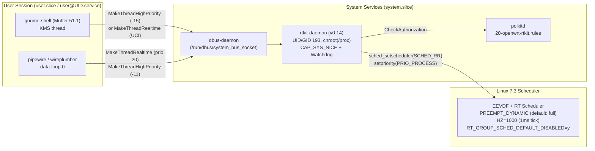

# Plan: RealtimeKit (`rtkit`) and Linux 7.3 Preemption Model for the GNOME Desktop

Status: plan approved by the user on 2026-11-11 and revised the same day after a review against
the source tree. Source changes for both phases were implemented on 2026-11-11 and pass the host
checks recorded in [the validation record](rtkit-validation.md); the reserved-generation build
and the runtime checks in §4.3 are still open.

Revision summary (2026-11-11 review):

- §3.2.3/§3.2.4 rewritten to match the real `desktop.init` (a `systemd-run` argument list) and
  the 21-line `desktop-session`; the earlier snippets described files that do not exist.
- Polkit rule narrowed to the `audio` and `video` groups (`render` also contains `libvirt-qemu`).
- `CONFIG_UCLAMP_TASK` dropped: PipeWire leaves `uclamp.*` commented out and the router runs
  `intel_pstate` in active (HWP) mode, where utilization clamps have no effect.
- `KERNEL_RT_GROUP_SCHED_DEFAULT_DISABLED` defaults to `n` in `config/Config-kernel.in`; the
  desktop fragment selects it, so stock x86_64 builds are unchanged.
- Work is split into two phases: userspace first (validated with `rt_group_sched=0` on the
  current kernel), then the kernel configuration as a new reserved kernel generation.
- A validation record `docs/rtkit-validation.md` is added to the deliverables.

---

## 1. Context & Problem Statement

This customized OpenWrt distribution (`x86_64`, `glibc`, native `systemd`, Linux 7.3, GNOME 51)
serves simultaneously as a production router and an interactive Wayland desktop / remote streaming
host (local VT7 KMS display, LAN RDP via `gnome-remote-desktop`, and Sunshine/Moonlight).

Three system-architecture gaps currently prevent the desktop and audio stack from achieving the
frame-pacing and audio-latency guarantees expected of a primary desktop Linux distribution:

1. **Missing `rtkit` (`org.freedesktop.RealtimeKit1`) system service**:
   - **Mutter 51 (`gnome-shell`)** exclusively uses D-Bus `org.freedesktop.RealtimeKit1`
     (`MakeThreadHighPriority` / `MakeThreadRealtime`) to elevate its native backend `KMS thread`.
     Without `rtkit`, `gnome-shell` logs `"Failed to make thread 'KMS thread' high priority"` on
     every session startup, falls back to `SCHED_OTHER` (`nice 0`), and **disables its KMS frame
     deadline timer** (`is_using_deadline_timer()` in `meta-kms-impl-device.c` only enables
     `META_DEADLINE_TIMER_STATE_ENABLED` when thread priority elevation succeeds).
   - **PipeWire 1.6 (`pipewire` / `wireplumber`)** loads `libpipewire-module-rt` with
     `nice.level = -11` and `rt.prio = 88`. Because `rtkit` is absent and unprivileged processes in
     `user.slice` lack `CAP_SYS_NICE` / `RLIMIT_RTPRIO`, PipeWire's `data-loop.0` audio thread
     runs at `SCHED_OTHER` (`nice 0`), making it vulnerable to audio xruns under CPU contention.
2. **`CONFIG_RT_GROUP_SCHED=y` blocks `SCHED_FIFO` / `SCHED_RR` in cgroup v2 slices**:
   - `target/linux/x86/64/config-7.3` enables `CONFIG_RT_GROUP_SCHED=y` without
     `CONFIG_RT_GROUP_SCHED_DEFAULT_DISABLED=y`.
   - Under native `systemd`'s unified cgroup v2 hierarchy (`/sys/fs/cgroup`), non-root task groups
     (`system.slice`, `user.slice`, `openwrt.slice`) have no legacy cgroup v1 `cpu.rt_runtime_us`
     allocation (`rt_runtime = 0`). Consequently, the kernel's `rt_schedulable()` check rejects
     `sched_setscheduler(SCHED_FIFO | SCHED_RR)` with `EPERM` for **all** processes outside the root
     cgroup—even if the caller holds `CAP_SYS_NICE` (including `rtkit-daemon.service` in
     `system.slice` and `gnome-shell` / `pipewire` in `user.slice`).
3. **Server-oriented kernel preemption and tick configuration (`PREEMPT_LAZY` + `HZ=100`)**:
   - The current Linux 7.3 kernel runs with `CONFIG_PREEMPT_LAZY=y`, `CONFIG_HZ_100=y` (10 ms tick)
     and `# CONFIG_PREEMPT_DYNAMIC is not set`.
   - Under `PREEMPT_LAZY` + `HZ=100`, EEVDF fair-class wakeup preemption sets only the lazy
     resched bit (`resched_curr_lazy()`) without sending a remote reschedule IPI; a woken thread can
     wait up to a full 10 ms tick behind a CPU-bound background task before preemption occurs.
   - Realtime-class wakeups are **not** lazy: once gap 1 and gap 2 are fixed, PipeWire's
     `SCHED_RR` `data-loop.0` preempts immediately even under `PREEMPT_LAZY`. The fair-class
     Mutter `KMS thread` (`nice -15` in the default `high-priority` mode) is the main beneficiary
     of `preempt=full` and `HZ=1000`, which is why the kernel change is a separate second phase
     (see [§4](#4-verification-plan)).



---

## 2. Settled Design Decisions

The following architectural choices were confirmed with the user during planning:

| ID | Topic | Decision |
|---|---|---|
| **A1** | Kernel preemption model and tick rate | Enable **`CONFIG_PREEMPT_DYNAMIC=y`** + **`CONFIG_PREEMPT=y`** (defaulting to `preempt=full` low-latency desktop preemption, boot switchable via `preempt=full\|lazy` and the other modes `sched_dynamic` accepts) + **`CONFIG_HZ_1000=y`** (`HZ=1000`, 1 ms tick). `CONFIG_UCLAMP_TASK` stays disabled (see [§8.7](#87-pipewire-1611-libpipewire-module-rt-and-why-uclamp-is-not-enabled)). Delivered in phase 2 as a new kernel generation. |
| **A2** | Unlocking `SCHED_RR` / `SCHED_FIFO` under cgroup v2 | Keep `CONFIG_RT_GROUP_SCHED=y` and enable **`CONFIG_RT_GROUP_SCHED_DEFAULT_DISABLED=y`** (`CONFIG_KERNEL_RT_GROUP_SCHED_DEFAULT_DISABLED=y`). This flips the kernel static key `rt_group_sched` to `false` by default so cgroup v2 services/sessions can acquire RT scheduling, while preserving the `rt_group_sched=0\|1` kernel boot parameter. Phase 1 gets the same effect on the current kernel with `rt_group_sched=0` on the kernel command line. |
| **A3** | Mutter `KMS thread` scheduling policy | Default to Mutter's upstream policy (**`high-priority`**, `nice -15` via RTKit, which automatically activates Mutter's KMS frame deadline timer) while PipeWire audio threads use `SCHED_RR` priority 20. Expose a UCI option **`option kms_scheduling 'high-priority'`** in `/etc/config/desktop` accepting `'high-priority'`, `'realtime'`, or `'normal'`. |

---

## 3. Detailed Implementation Plan

### 3.1 New Custom Package: `package/custom/rtkit` (`v0.14`)

Create `package/custom/rtkit` packaging Freedesktop's `pipewire/rtkit` `0.14` release.

#### 3.1.1 `package/custom/rtkit/Makefile` (NEW)

Use tabs for Makefile recipe indentation:

```makefile
include $(TOPDIR)/rules.mk

PKG_NAME:=rtkit
PKG_VERSION:=0.14
PKG_RELEASE:=1

PKG_SOURCE:=$(PKG_NAME)-v$(PKG_VERSION).tar.gz
PKG_SOURCE_URL:=https://gitlab.freedesktop.org/pipewire/rtkit/-/archive/v$(PKG_VERSION)
PKG_HASH:=55dd379b11f52b81655e2dc676de9d602d050cb0beb18ef01f0f65569f0a5e59
PKG_BUILD_DIR:=$(BUILD_DIR)/$(PKG_NAME)-v$(PKG_VERSION)

PKG_MAINTAINER:=OpenWrt Desktop Integration
PKG_LICENSE:=GPL-3.0-or-later BSD-3-Clause
PKG_LICENSE_FILES:=LICENSE GPL

include $(INCLUDE_DIR)/package.mk
include $(INCLUDE_DIR)/meson.mk

define Package/rtkit
  SECTION:=utils
  CATEGORY:=Utilities
  TITLE:=Realtime Policy and Watchdog Daemon
  URL:=https://gitlab.freedesktop.org/pipewire/rtkit
  DEPENDS:=@TARGET_x86_64 @USE_GLIBC @OPENWRT_SYSTEMD +dbus +libdbus +libcap +libsystemd +polkit +librt +libpthread
  USERID:=rtkit=193:rtkit=193
endef

define Package/rtkit/description
  RealtimeKit is a D-Bus system service that changes the scheduling policy of
  user processes/threads to SCHED_RR (realtime scheduling mode) or high-priority
  nice levels on request, guarded by Polkit and a canary-based RT watchdog.
endef

MESON_ARGS += \
	-Dinstalled_tests=false \
	-Dlibsystemd=enabled \
	-Dsystemd_systemunitdir=/usr/lib/systemd/system

define Package/rtkit/install
	$(INSTALL_DIR) $(1)/usr/libexec $(1)/usr/sbin
	$(INSTALL_BIN) $(PKG_INSTALL_DIR)/usr/libexec/rtkit-daemon $(1)/usr/libexec/
	$(INSTALL_BIN) $(PKG_INSTALL_DIR)/usr/sbin/rtkitctl $(1)/usr/sbin/

	$(INSTALL_DIR) $(1)/usr/share/dbus-1/system-services
	$(INSTALL_DATA) $(PKG_INSTALL_DIR)/usr/share/dbus-1/system-services/org.freedesktop.RealtimeKit1.service \
		$(1)/usr/share/dbus-1/system-services/

	$(INSTALL_DIR) $(1)/usr/share/dbus-1/system.d
	$(INSTALL_DATA) $(PKG_INSTALL_DIR)/usr/share/dbus-1/system.d/org.freedesktop.RealtimeKit1.conf \
		$(1)/usr/share/dbus-1/system.d/

	$(INSTALL_DIR) $(1)/usr/share/dbus-1/interfaces
	$(INSTALL_DATA) $(PKG_INSTALL_DIR)/usr/share/dbus-1/interfaces/org.freedesktop.RealtimeKit1.xml \
		$(1)/usr/share/dbus-1/interfaces/

	$(INSTALL_DIR) $(1)/usr/share/polkit-1/actions $(1)/usr/share/polkit-1/rules.d
	$(INSTALL_DATA) $(PKG_INSTALL_DIR)/usr/share/polkit-1/actions/org.freedesktop.RealtimeKit1.policy \
		$(1)/usr/share/polkit-1/actions/
	$(INSTALL_DATA) ./files/20-openwrt-rtkit.rules \
		$(1)/usr/share/polkit-1/rules.d/20-openwrt-rtkit.rules

	$(INSTALL_DIR) $(1)/usr/lib/systemd/system $(1)/usr/lib/systemd/system/rtkit-daemon.service.d
	$(INSTALL_DATA) $(PKG_INSTALL_DIR)/usr/lib/systemd/system/rtkit-daemon.service \
		$(1)/usr/lib/systemd/system/
	$(INSTALL_DATA) ./files/rtkit-service.conf \
		$(1)/usr/lib/systemd/system/rtkit-daemon.service.d/openwrt.conf
endef

$(eval $(call BuildPackage,rtkit))
```

#### 3.1.2 `package/custom/rtkit/files/rtkit-service.conf` (NEW)

```ini
[Unit]
Requires=dbus.service
After=dbus.service polkit.service

[Service]
# dbus is built with /var/run/dbus/system_bus_socket as its compiled-in system
# socket while systemd's dbus.socket listens on /run; use the canonical path,
# as the polkit, colord and upower drop-ins do.
Environment=DBUS_SYSTEM_BUS_ADDRESS=unix:path=/run/dbus/system_bus_socket
```

#### 3.1.3 `package/custom/rtkit/files/20-openwrt-rtkit.rules` (NEW)

```javascript
// Active and inactive local sessions are already allowed by the upstream
// org.freedesktop.RealtimeKit1.policy. Also grant users enrolled by
// desktop-setup (video) or desktop-audio-setup (audio) so that services in
// user@UID.service are authorized in RDP-only and headless sessions.
// Do not use "render": libvirt-qemu is a member of it.
polkit.addRule(function(action, subject) {
    if ((action.id === "org.freedesktop.RealtimeKit1.acquire-high-priority" ||
         action.id === "org.freedesktop.RealtimeKit1.acquire-real-time") &&
        (subject.isInGroup("audio") || subject.isInGroup("video"))) {
        return polkit.Result.YES;
    }
});
```

#### 3.1.4 `configs/custom-package-updates.json` (MODIFY)

Add `rtkit` in alphabetical order among the existing keys (same shape as the `geoclue` and
`accountsservice` entries):

```json
    "rtkit": {
      "provider": "gitlab",
      "policy": "series",
      "host": "https://gitlab.freedesktop.org",
      "project": "pipewire/rtkit"
    },
```

---

### 3.2 Desktop & Audio Integration (`openwrt-desktop` and `openwrt-desktop-audio`)

#### 3.2.1 `package/custom/openwrt-desktop/Makefile` (MODIFY)

- Increment `PKG_RELEASE` from `26` to `27`.
- Add `+rtkit` to `DEPENDS` of `Package/openwrt-desktop`.

#### 3.2.2 `package/custom/openwrt-desktop/files/desktop.config` (MODIFY)

Add `option kms_scheduling 'high-priority'`:

```uci
config desktop 'main'
	option enabled '0'
	option user ''
	option output 'auto'
	option mode 'preferred'
	option kms_scheduling 'high-priority'
	option sunshine_capture 'portal'
	option rdp_enabled '0'
	option rdp_port '3389'
```

#### 3.2.3 `package/custom/openwrt-desktop/files/desktop.init` (MODIFY)

`start_service()` does not use `procd_set_param`; it builds a `systemd-run` argument list with
`set -- systemd-run … --setenv=…` and finally runs `"$@" /usr/libexec/desktop-session`.

1. Add `kms_scheduling` to the existing `local enabled user secret` line.
2. After `config_get user main user`, read and validate the option, using the existing
   `desktop_error` helper from `desktop-common.sh`:
   ```sh
   	config_get kms_scheduling main kms_scheduling high-priority
   	case "$kms_scheduling" in
   		high-priority|realtime|normal) ;;
   		*) desktop_error "Invalid kms_scheduling '$kms_scheduling' (expected high-priority, realtime or normal)"; return 1 ;;
   	esac
   ```
3. Append `--setenv=OPENWRT_DESKTOP_KMS_SCHEDULING="$kms_scheduling"` to the
   `set -- systemd-run …` list, next to the existing `--setenv=XDG_SESSION_CLASS=user`.

#### 3.2.4 `package/custom/openwrt-desktop/files/desktop-session` (MODIFY)

The script is 21 lines. Line 16 already clears stale variables from the user manager
(`systemctl --user unset-environment WAYLAND_SOCKET GTK_IM_MODULE GTK_IM_MODULE_FILE
LIBSEAT_BACKEND`) and line 20 imports a short, deliberate list. Keep that list; do **not** import
`PATH`, `LANG`, `GTK_IM_MODULE` or other variables (the script intentionally unsets
`GTK_IM_MODULE`).

1. Add `MUTTER_DEBUG_KMS_SCHEDULING_PRIORITY` to the existing `unset` (line 10) and
   `systemctl --user unset-environment` (line 16) lists. This clears a stale override left in a
   surviving `user@UID.service` after switching back from `realtime`/`normal` (see §8.6).
2. Before line 20, export the override only for non-default modes and add it to the import list:
   ```sh
   import_kms=
   case "${OPENWRT_DESKTOP_KMS_SCHEDULING:-high-priority}" in
   	realtime|normal)
   		export MUTTER_DEBUG_KMS_SCHEDULING_PRIORITY="$OPENWRT_DESKTOP_KMS_SCHEDULING"
   		import_kms=MUTTER_DEBUG_KMS_SCHEDULING_PRIORITY
   		;;
   esac
   systemctl --user import-environment XDG_CURRENT_DESKTOP XDG_SESSION_DESKTOP DESKTOP_SESSION XDG_SESSION_TYPE XMODIFIERS XDG_DATA_DIRS $import_kms
   ```
   (`$import_kms` is intentionally unquoted so it expands to nothing in the default mode; the
   script runs with `set -eu`, so it must be initialized.)

#### 3.2.5 `package/custom/openwrt-desktop-audio/Makefile` (MODIFY)

- Increment `PKG_RELEASE` from `3` to `4`.
- Add `+rtkit` to `DEPENDS` of `Package/openwrt-desktop-audio`.

---

### 3.3 Linux 7.3 Kernel Preemption, Tick Frequency, and `RT_GROUP_SCHED` (Phase 2)

This section is phase 2. It changes the kernel configuration and therefore the kernel ABI, so it
must be built as a new reserved kernel generation (`python3 scripts/build-and-publish.py
build-only …` or the wrappers), never with a plain full `make` (see CLAUDE.md, "Plain make does
not reserve a kernel build number"). Phase 1 (§3.1, §3.2) does not depend on it.

> [!WARNING]
> **Critical Build-System Rule**: `include/kernel-defaults.mk` appends `CONFIG_KERNEL_*` symbols
> (stripped of the `KERNEL_` prefix) from top-level `.config` to `$(LINUX_DIR)/.config.target`
> **after** `target/linux/x86/64/config-7.3`. Therefore, setting `CONFIG_PREEMPT=y` in
> `target/linux/x86/64/config-7.3` alone is **not sufficient**—you **must** also update
> `config/Config-kernel.in`, `configs/gnome-desktop.config`, `.config`, and
> `configs/x86-64-systemd-desktop.config` (see [§8.2](#82-build-system-trap-includekernel-defaultsmk-overrides-target-kernel-configs)).

#### 3.3.1 `config/Config-kernel.in` (MODIFY)

Directly after `config KERNEL_RT_GROUP_SCHED` (around line 1106 of `config/Config-kernel.in`,
inside the `if KERNEL_CGROUP_SCHED` block, so keep its two-tab indentation), add:

```kconfig
		config KERNEL_RT_GROUP_SCHED_DEFAULT_DISABLED
			bool "Require boot parameter to enable group scheduling for SCHED_RR/FIFO"
			default n
			depends on KERNEL_RT_GROUP_SCHED
			help
			  Disable RT group scheduling by default so cgroup v2 services and
			  desktop sessions (rtkit, PipeWire, Mutter) can acquire SCHED_RR
			  and SCHED_FIFO without legacy cgroup v1 rt_runtime allocation.
			  Pass rt_group_sched=1 on the kernel command line to re-enable.
```

#### 3.3.2 `target/linux/x86/64/config-7.3` (MODIFY)

`HZ` is not exposed through `config/Config-kernel.in` (the generic config sets `CONFIG_HZ=100`),
so the target config is the only place to change it. Replace line 587 `CONFIG_PREEMPT_LAZY=y`
and its comment on line 586, and add the remaining symbols in the file's sorted order. Leave the
existing `# CONFIG_UCLAMP_TASK is not set` (line 476) unchanged:

```kconfig
# CONFIG_HZ_100 is not set
CONFIG_HZ_1000=y
CONFIG_HZ=1000
CONFIG_PREEMPT=y
CONFIG_PREEMPT_DYNAMIC=y
# CONFIG_PREEMPT_LAZY is not set
CONFIG_RT_GROUP_SCHED_DEFAULT_DISABLED=y
```

The `PREEMPT*` and `RT_GROUP_SCHED_DEFAULT_DISABLED` lines are overridden by the
`CONFIG_KERNEL_*` lines appended from the top-level `.config` (§8.2); they are kept here so the
target config documents the intended state.

#### 3.3.3 `configs/gnome-desktop.config` and `configs/x86-64-systemd-desktop.config` (MODIFY)

`CONFIG_PACKAGE_rtkit=y` belongs to phase 1 and is merged first (§8.8 phase 1, step 4); the
`CONFIG_KERNEL_*` lines below are added in phase 2.

1. In `configs/gnome-desktop.config`, add:
   ```kconfig
   CONFIG_KERNEL_PREEMPT=y
   # CONFIG_KERNEL_PREEMPT_NONE is not set
   CONFIG_KERNEL_RT_GROUP_SCHED_DEFAULT_DISABLED=y
   CONFIG_PACKAGE_rtkit=y
   ```
2. Merge into `.config` without wiping existing settings:
   ```sh
   ./scripts/kconfig.pl + .config configs/gnome-desktop.config > .config.new
   mv .config.new .config
   make defconfig
   ```
3. Verify in `.config` that:
   - `CONFIG_KERNEL_PREEMPT=y`
   - `# CONFIG_KERNEL_PREEMPT_NONE is not set`
   - `CONFIG_KERNEL_RT_GROUP_SCHED=y`
   - `CONFIG_KERNEL_RT_GROUP_SCHED_DEFAULT_DISABLED=y`
   - `CONFIG_PACKAGE_rtkit=y`
4. Sync the accepted full configuration snapshot:
   - Update `configs/x86-64-systemd-desktop.config` with the same symbols (or copy normalized `.config` if no unrelated local `.config` drift exists—inspect `git diff configs/x86-64-systemd-desktop.config` carefully before staging).

---

### 3.4 Tests & Documentation

#### 3.4.1 `scripts/tests/test-rtkit-desktop.py` (NEW)

Create a host Python `unittest` suite (4-space indentation) covering:
1. **`rtkit` recipe and update registry**:
   - `configs/custom-package-updates.json` registers `"rtkit"` with `"provider": "gitlab"`, `"host": "https://gitlab.freedesktop.org"`, `"project": "pipewire/rtkit"`.
   - `package/custom/rtkit/Makefile` sets `USERID:=rtkit=193:rtkit=193`, depends on `+dbus +libdbus +libcap +libsystemd +polkit +librt +libpthread`, and installs `rtkit-daemon`, `rtkitctl`, D-Bus service/policy/interface files, Polkit action + `20-openwrt-rtkit.rules`, and `rtkit-daemon.service.d/openwrt.conf`.
   - `20-openwrt-rtkit.rules` checks `org.freedesktop.RealtimeKit1.acquire-high-priority` and `org.freedesktop.RealtimeKit1.acquire-real-time`, grants `polkit.Result.YES` for `subject.isInGroup("audio") || subject.isInGroup("video")`, and does not mention `render`.
   - `rtkit-service.conf` sets `Environment=DBUS_SYSTEM_BUS_ADDRESS=unix:path=/run/dbus/system_bus_socket`.
2. **`openwrt-desktop` and `openwrt-desktop-audio` integration**:
   - Both Makefiles depend on `+rtkit`.
   - `desktop.config` defines `option kms_scheduling 'high-priority'`.
   - Simulated runs of `desktop.init` (following the pattern in `scripts/tests/test-desktop-audio.py` or `scripts/tests/test-network-wait-online.py`, with stubbed `systemd-run`, `uci`/`config_get` and `desktop-common.sh` helpers) verify that `kms_scheduling` accepts `high-priority`, `realtime`, and `normal`, that the recorded `systemd-run` arguments contain `--setenv=OPENWRT_DESKTOP_KMS_SCHEDULING=...`, and that invalid values return non-zero.
   - Simulated runs of `desktop-session` (stub `systemctl`, `desktop-keyring-unlock` and `gnome-session`) verify that `unset-environment` always lists `MUTTER_DEBUG_KMS_SCHEDULING_PRIORITY`, that `import-environment` includes it only for `realtime`/`normal`, and that the import list otherwise stays exactly the existing six variables.
3. **Kernel configuration consistency**:
   - `config/Config-kernel.in` defines `KERNEL_RT_GROUP_SCHED_DEFAULT_DISABLED`.
   - `config/Config-kernel.in` gives `KERNEL_RT_GROUP_SCHED_DEFAULT_DISABLED` `default n`.
   - `target/linux/x86/64/config-7.3` sets `CONFIG_HZ_1000=y`, `CONFIG_HZ=1000`, `CONFIG_PREEMPT=y`, `CONFIG_PREEMPT_DYNAMIC=y`, `# CONFIG_PREEMPT_LAZY is not set`, `CONFIG_RT_GROUP_SCHED_DEFAULT_DISABLED=y`, and keeps `# CONFIG_UCLAMP_TASK is not set`.
   - Split the kernel assertions into their own test class so phase 1 can land with them skipped or absent.
   - `configs/gnome-desktop.config` and `configs/x86-64-systemd-desktop.config` set `CONFIG_KERNEL_PREEMPT=y`, `# CONFIG_KERNEL_PREEMPT_NONE is not set`, `CONFIG_KERNEL_RT_GROUP_SCHED_DEFAULT_DISABLED=y`, and `CONFIG_PACKAGE_rtkit=y`.

#### 3.4.2 `scripts/tests/gnome-desktop-guest.py` (MODIFY)

Extend the guest VM verification script so that when the desktop session is up:
- `systemctl show -p LoadState --value rtkit-daemon.service` equals `loaded`.
- The `gnome-shell` process's `KMS thread` (under `/proc/<pid>/task/<tid>/stat` or `chrt`/`ps`) has either `nice < 0` (e.g., `-15` in default `high-priority` mode) or a realtime policy (`SCHED_RR` / `SCHED_FIFO` when `kms_scheduling='realtime'`), and `journalctl` for `gnome-shell` does **not** contain `"Failed to make thread 'KMS thread'"`.

#### 3.4.3 Documentation Updates (MODIFY)

1. `docs/gnome-desktop.md`:
   - Document `rtkit` integration (`rtkit-daemon.service`, Polkit rule `20-openwrt-rtkit.rules`).
   - Document `option kms_scheduling 'high-priority'` (`high-priority` | `realtime` | `normal`) in `/etc/config/desktop`.
   - Document the Linux 7.3 desktop preemption and realtime scheduling baseline (`CONFIG_PREEMPT_DYNAMIC=y` with default `preempt=full`, `CONFIG_HZ_1000=y`, `CONFIG_RT_GROUP_SCHED_DEFAULT_DISABLED=y`), and the phase-1 `rt_group_sched=0` boot parameter for kernels built before phase 2.
2. `package/base-files/system-description.systemd.md` & `package/base-files/Makefile`:
   - Update the GNOME desktop & kernel architecture summary in `package/base-files/system-description.systemd.md` to mention `rtkit`, `kms_scheduling`, and `PREEMPT_DYNAMIC` / `HZ=1000` / `RT_GROUP_SCHED_DEFAULT_DISABLED`.
   - Increment the suffix of `PKG_RELEASE:=$(COMMITCOUNT).9` in `package/base-files/Makefile` (to `.10`).
3. `docs/rtkit-validation.md` (NEW): hand-written validation record in the repository's usual
   format (image path and SHA-256, `| Check | Result |` table, explicit scope statement, and an
   **Evidence** pointer to a dated workspace outside the repository) covering the §4.3 checks
   for each phase.

---

## 4. Verification Plan

### 4.1 Host Automated Tests & Package Builds

Run from `/srv/openwrt`:

```sh
# 1. Regenerate feed indexes so package/feeds/custom/rtkit symlink is created
./scripts/feeds update -i -a
./scripts/feeds install -a rtkit

# 2. Normalize .config after merging configs/gnome-desktop.config
make defconfig

# 3. Run host unit tests
python3 scripts/tests/test-custom-package-updates.py
python3 scripts/tests/test-rtkit-desktop.py
python3 scripts/tests/test-desktop-audio.py
python3 scripts/tests/test-mainline-kernel-updates.py

# 4. Compile userspace packages
make package/custom/rtkit/compile V=s
make package/custom/openwrt-desktop/compile V=s
make package/custom/openwrt-desktop-audio/compile V=s
make package/base-files/compile V=s

# 5. Check dependency contract and whitespace hygiene
scripts/deptest.sh rtkit
git diff --check
```

Phase 2 additionally needs a full build with a reserved kernel generation:

```sh
python3 scripts/build-and-publish.py build-only -j12 V=s
```

Publication (`scripts/publish-changed-feeds.sh`) and booting the result on the physical router
remain separate steps that need explicit authorization.

### 4.2 Kernel Config Resolution Check

Verify that OpenWrt's kernel config merge (`$(LINUX_CONF_CMD)` + `CONFIG_KERNEL_*` override in `include/kernel-defaults.mk`) produces the expected effective symbols without building a full image if not yet requested:

```sh
# Check what the top-level .config will append to .config.target:
awk '/^(#[[:space:]]+)?CONFIG_KERNEL/{sub("CONFIG_KERNEL_","CONFIG_");print}' .config | grep -E 'PREEMPT|RT_GROUP_SCHED|HZ'
```

Expected output from the `awk` filter:
- `# CONFIG_PREEMPT_NONE is not set`
- `# CONFIG_PREEMPT_VOLUNTARY is not set`
- `CONFIG_PREEMPT=y`
- `CONFIG_RT_GROUP_SCHED=y`
- `CONFIG_RT_GROUP_SCHED_DEFAULT_DISABLED=y`

### 4.3 Target / VM Runtime Checks (When Authorized to Build Image or Deploy)

**Phase 1 (current kernel):** install the phase-1 packages, add `rt_group_sched=0` to the kernel
command line for one boot (the current Linux 7.3 kernel has `CONFIG_RT_GROUP_SCHED=y`, so the
parameter is honoured, and `kernelctl` preserves it in `state['bootargs']`), then run checks 2
and 3 below. Record a `resbench`/routing-latency baseline in the same boot, so phase 2 can be
judged against it (see [§7](#7-interaction-with-resource-governor-plan-docsresource-governor-planmd)).
Check 1 applies only to phase 2.

1. **Kernel preemption & RT group scheduling state**:
   ```sh
   zcat /proc/config.gz | grep -E 'CONFIG_(PREEMPT|HZ|RT_GROUP_SCHED)'
   sudo -n cat /sys/kernel/debug/sched/preempt
   # Expected: "none voluntary (full) lazy" with (full) active
   ```
2. **`rtkit-daemon`, `gnome-shell` (`KMS thread`), and `pipewire` (`data-loop.0`)**:
   ```sh
   systemctl status rtkit-daemon.service
   ps -eLo pid,tid,cls,rtprio,ni,comm | grep -E 'rtkit|KMS thread|pipewire|data-loop'
   ```
   Expected thread scheduling:
   - `rtkit-watchdog`: `cls=RR`, `rtprio=99`
   - `KMS thread` (`gnome-shell`):
     - Default (`kms_scheduling='high-priority'`): `cls=TS`, `ni=-15`
     - With `uci set desktop.main.kms_scheduling='realtime'`: `cls=RR`, `rtprio=20`
   - `pipewire` main thread: `cls=TS`, `ni=-11`
   - `data-loop.0` (`pipewire` / `wireplumber`): `cls=RR`, `rtprio=20`
3. **Mutter KMS deadline timer verification**:
   ```sh
   journalctl -b --user-unit=org.gnome.Shell@user.service | grep -E 'KMS thread|deadline'
   ```
   Confirm no `"Failed to make thread 'KMS thread' high priority"` warning appears.

---

## 5. Rollback

- **Mutter KMS scheduling mode (runtime, no reboot)**:
  ```sh
  uci set desktop.main.kms_scheduling='high-priority' # or 'normal'
  uci commit desktop
  /etc/init.d/desktop restart
  ```
- **Kernel preemption mode (boot parameter or runtime debugfs without rebuilding kernel)**:
  - Boot parameter: append `preempt=lazy` (or `preempt=voluntary` / `preempt=none`) to GRUB cmdline.
  - Runtime (if `CONFIG_SCHED_DEBUG` debugfs is mounted):
    `echo lazy | sudo -n tee /sys/kernel/debug/sched/preempt`.
- **`RT_GROUP_SCHED` behavior (boot parameter without rebuilding kernel)**:
  - Append `rt_group_sched=1` to GRUB cmdline to restore legacy cgroup RT group scheduling, or `rt_group_sched=0` on older kernel generations that lacked `CONFIG_RT_GROUP_SCHED_DEFAULT_DISABLED=y`.
- **Previous kernel generation**:
  - `kernelctl` keeps the previous kernel generation as fallback in GRUB (`/etc/openwrt-kernel/`).

---

## 6. Files Summary

**New files**:
- `docs/rtkit-preemption-plan.md` (this document)
- `package/custom/rtkit/Makefile`
- `package/custom/rtkit/files/rtkit-service.conf`
- `package/custom/rtkit/files/20-openwrt-rtkit.rules`
- `scripts/tests/test-rtkit-desktop.py`
- `docs/rtkit-validation.md`

**Modified files** (phase 1 unless marked):
- `configs/custom-package-updates.json`
- `package/custom/openwrt-desktop/Makefile`
- `package/custom/openwrt-desktop/files/desktop.config`
- `package/custom/openwrt-desktop/files/desktop.init`
- `package/custom/openwrt-desktop/files/desktop-session`
- `package/custom/openwrt-desktop-audio/Makefile`
- `config/Config-kernel.in` (phase 2)
- `target/linux/x86/64/config-7.3` (phase 2)
- `configs/gnome-desktop.config` (`CONFIG_PACKAGE_rtkit=y` in phase 1; kernel symbols in phase 2)
- `configs/x86-64-systemd-desktop.config` (same split)
- `scripts/tests/gnome-desktop-guest.py`
- `docs/gnome-desktop.md`
- `package/base-files/system-description.systemd.md`
- `package/base-files/Makefile`

---

## 7. Interaction with Resource Governor Plan (`docs/resource-governor-plan.md`)

In `docs/resource-governor-plan.md` (§1 line 47, §1 Hypotheses H2/H7, and Track R), two issues were
flagged for later evaluation:
1. Fair-class wakeup latency under `PREEMPT_LAZY` + `HZ=100` (Hypothesis H2).
2. Missing `rtkit` and `RT_GROUP_SCHED=y` blocking compositor and audio RT threads (Hypothesis H7 / Track R).

Once this plan is built and deployed to the router, `PREEMPT_DYNAMIC` (`preempt=full`), `HZ=1000`,
`RT_GROUP_SCHED_DEFAULT_DISABLED=y`, and `rtkit` will already be active. Any future `resbench`
baseline (`B0`) measurements for `docs/resource-governor-plan.md` should record the new kernel
cmdline / `preempt` state and verify that `KMS thread` (`nice -15`) and PipeWire (`SCHED_RR` prio 20)
do not regress routing latency metrics (P1–P3).

---

## 8. Handoff Notes for the Implementing Agent

This section records non-obvious technical findings, source-level verifications, and repository
pitfalls discovered while researching the codebase on 2026-11-11. Read every subsection below
before starting implementation.

### 8.1 Upstream `rtkit` Moved to Freedesktop GitLab (`v0.14` vs Broken `v0.13`)

- **Do NOT use `https://github.com/heftig/rtkit` (`v0.13`)**:
  - `heftig/rtkit` stopped at `v0.13` (2020). Its `meson.build` contains a well-known upstream bug on
    line 17:
    ```meson
    librt_dep = cc.find_library('z')
    ```
    (looking up `libz` instead of `librt`!), uses deprecated Meson `.get_pkgconfig_variable()`,
    hard-requires `xxd` at build time to generate `xml-introspection.h`, and lacks support for
    `org.freedesktop.DBus.Properties.GetAll` (which causes `xdg-desktop-portal` and modern D-Bus
    clients to fail property introspection on `org.freedesktop.RealtimeKit1`).
- **Use `https://gitlab.freedesktop.org/pipewire/rtkit` (`v0.14`)**:
  - Upstream maintenance moved under the Freedesktop PipeWire group.
  - Tag `v0.14` (commit `7a98df183db65e89737f4e99bc23c38ffb02a828`) fixes `cc.find_library('rt')`,
    implements `org.freedesktop.DBus.Properties.GetAll`, makes `xxd` optional by falling back to a
    shipped `files('xml-introspection.h')`, and uses modern Meson `.get_variable()`.
  - Tarball URL: `https://gitlab.freedesktop.org/pipewire/rtkit/-/archive/v0.14/rtkit-v0.14.tar.gz`
  - Unpacks to: `$(BUILD_DIR)/rtkit-v0.14` (so set `PKG_BUILD_DIR:=$(BUILD_DIR)/$(PKG_NAME)-v$(PKG_VERSION)`).
  - Verified SHA-256 (`PKG_HASH`):
    `55dd379b11f52b81655e2dc676de9d602d050cb0beb18ef01f0f65569f0a5e59`.
  - `scripts/update-custom-packages.py` natively supports `"provider": "gitlab"` with `"host": "https://gitlab.freedesktop.org"` and `"project": "pipewire/rtkit"` (same pattern as the `accountsservice` and `geoclue` entries in `configs/custom-package-updates.json`; note that `pipewire` itself is registered with the `github` provider).
  - The tarball and hash were re-downloaded and re-verified on 2026-11-11. Its
    `meson_options.txt` provides `installed_tests`, `libsystemd`, `systemd_systemunitdir`,
    `dbus_systemservicedir`, `dbus_rulesdir`, `dbus_interfacedir` and `polkit_actiondir`;
    `rtkit-daemon` links `dbus-1`, `libcap`, `rt`, `libsystemd` and threads, and installs into
    `libexecdir`, `rtkitctl` into `sbindir`. `polkit-gobject-1` is only an optional lookup for
    the action directory (polkit is a runtime dependency only).

### 8.2 Build-System Trap: `include/kernel-defaults.mk` Overrides Target Kernel Configs

- **Where the trap is**: inspect `include/kernel-defaults.mk` lines 113–125 (`Kernel/Configure/Default`):
  ```makefile
  $(LINUX_CONF_CMD) > $(LINUX_DIR)/.config.target
  # copy CONFIG_KERNEL_* settings over to .config.target
  awk '/^(#[[:space:]]+)?CONFIG_KERNEL/{sub("CONFIG_KERNEL_","CONFIG_");print}' $(TOPDIR)/.config >> $(LINUX_DIR)/.config.target
  ```
- **Why this matters**:
  1. `$(LINUX_CONF_CMD)` concatenates `target/linux/generic/config-7.3` and `target/linux/x86/64/config-7.3` into `.config.target`.
  2. Immediately afterward, `awk` extracts every `CONFIG_KERNEL_*` line (including `# CONFIG_KERNEL_PREEMPT is not set`!) from top-level `.config`, strips `KERNEL_`, and appends it to the **end** of `.config.target`.
  3. Previously, top-level `.config` had `CONFIG_KERNEL_PREEMPT_NONE=y` and `# CONFIG_KERNEL_PREEMPT is not set`. When Kbuild ran `olddefconfig` on Linux 7.3 `x86_64`, `CONFIG_PREEMPT_NONE` was rejected because on Linux 7.3 x86 (`arch/x86/Kconfig`), `PREEMPT_NONE` depends on `ARCH_NO_PREEMPT` (not selected on x86). Then Kbuild saw `# CONFIG_PREEMPT is not set` (appended from top-level `.config`!) and fell back to the Kconfig choice default `CONFIG_PREEMPT_LAZY=y`.
  4. **If you only put `CONFIG_PREEMPT=y` in `target/linux/x86/64/config-7.3` without changing `CONFIG_KERNEL_PREEMPT=y` in top-level `.config`, the `awk` step appends `# CONFIG_PREEMPT is not set` at the end of `.config.target` and silently overrides your change back to `CONFIG_PREEMPT_LAZY=y`!**
- **How to avoid the trap**:
  - Set `CONFIG_KERNEL_PREEMPT=y`, `# CONFIG_KERNEL_PREEMPT_NONE is not set`, and `CONFIG_KERNEL_RT_GROUP_SCHED_DEFAULT_DISABLED=y` in `configs/gnome-desktop.config`, `.config`, and `configs/x86-64-systemd-desktop.config`, **in addition to** updating `target/linux/x86/64/config-7.3` and `config/Config-kernel.in`.
  - Confirmed on 2026-11-11: `build_dir/target-x86_64_glibc/linux-x86_64/linux-7.3.3/.config` contains `# CONFIG_PREEMPT is not set` and `CONFIG_PREEMPT_LAZY=y`, the result of exactly this override.
  - In Linux 7.3, `PREEMPT_VOLUNTARY` also depends on `!ARCH_HAS_PREEMPT_LAZY`, which x86 selects, so `KERNEL_PREEMPT` is the only usable non-RT choice in OpenWrt's `Preemption Model` menu.

### 8.3 Why `CONFIG_RT_GROUP_SCHED=y` Broke cgroup v2 RT Scheduling (Verified in Linux 7.3.3 Source)

- Verified in `build_dir/target-x86_64_glibc/linux-x86_64/linux-7.3.3/kernel/sched/core.c` (lines 10374–10396) and `kernel/sched/sched.h` (line 2393):
  ```c
  #ifdef CONFIG_RT_GROUP_SCHED
  #ifdef CONFIG_RT_GROUP_SCHED_DEFAULT_DISABLED
  DEFINE_STATIC_KEY_FALSE(rt_group_sched);
  #else
  DEFINE_STATIC_KEY_TRUE(rt_group_sched);
  #endif

  static int __init setup_rt_group_sched(char *str)
  {
          int ret;
          bool enabled;

          ret = kstrtobool(str, &enabled);
          if (ret)
                  return 0;

          if (enabled)
                  static_branch_enable(&rt_group_sched);
          else
                  static_branch_disable(&rt_group_sched);

          return 1;
  }
  __setup("rt_group_sched=", setup_rt_group_sched);
  #endif /* CONFIG_RT_GROUP_SCHED */
  ```
- And in `kernel/sched/sched.h:2393`:
  ```c
  static inline struct task_group *task_group(struct task_struct *p)
  {
          struct task_group *tg;

          if (rt_task(p) && ! rt_group_sched_enabled())
                  return &root_task_group;
  ...
  ```
- When `rt_group_sched` is `true` (the old build), `task_group(p)` returns the task's cgroup v2 `task_group` (e.g. `system.slice/rtkit-daemon.service` or `user.slice/user-32769.slice/...`), whose `rt_bandwidth.rt_runtime` is `0` because cgroup v2 does not expose the legacy v1 `cpu.rt_runtime_us` controller. Thus `tg_has_rt_tasks()` / `rt_schedulable()` returns `-EPERM` on `sched_setscheduler()`.
- The `-EPERM` check is in `kernel/sched/syscalls.c:614` and applies only where the cpu controller gives the task a non-root task group. systemd 262's `user@.service` sets `Delegate=pids memory cpu`, so the cpu controller is enabled from the root down to `user@UID.service`: PipeWire and gnome-shell are affected, and once it is enabled at the root `system.slice` gets its own task group too.
- Even `rtkit-daemon` itself fails to initialize its internal `SCHED_RR` priority 99 watchdog thread unless `rt_group_sched_enabled()` is `false`!
- Enabling `CONFIG_RT_GROUP_SCHED_DEFAULT_DISABLED=y` compiles `DEFINE_STATIC_KEY_FALSE(rt_group_sched)` so all RT tasks use `&root_task_group` by default (`sched_rt_runtime_us = 950000` / `1000000`), while keeping `rt_group_sched=0|1` boot parameter support intact.
- **Bonus for testing on an existing running kernel before rebooting into a new kernel generation**:
  - On the currently running Linux 7.3 kernel (where `CONFIG_RT_GROUP_SCHED=y` is already compiled in with `setup_rt_group_sched`), passing `rt_group_sched=0` on the GRUB kernel command line disables the static branch at boot without needing a kernel rebuild. Note that `kernelctl` (`package/custom/openwrt-kernel-upgrade/files/kernelctl:265`) automatically preserves `rt_group_sched=*` from `/proc/cmdline` in `state['bootargs']`.

### 8.4 UID/GID Allocation (`193:193`), `chroot("/proc")`, and D-Bus Socket Path

- **UID/GID allocation across `package/custom/`**:
  - `package/system/systemd/Makefile`: `systemd-journal=190:systemd-journal=190`
  - `package/custom/libvirt/Makefile`: `libvirt-qemu=191:kvm=191`
  - `package/custom/polkit/Makefile`: `polkitd=192:polkitd=192`
  - Therefore, `package/custom/rtkit/Makefile` is assigned **`USERID:=rtkit=193:rtkit=193`**.
- **How `rtkit-daemon` drops privileges at startup**:
  - Upstream v0.14 `rtkit-daemon.service` is `Type=dbus` with `BusName=org.freedesktop.RealtimeKit1`, `NotifyAccess=main`, `PrivateNetwork=yes` and `CapabilityBoundingSet=CAP_SYS_NICE CAP_DAC_READ_SEARCH CAP_SYS_CHROOT CAP_SETGID CAP_SETUID`. It does **not** set `PrivateTmp`, `ProtectSystem` or `ProtectHome`.
  - During initialization (`rtkit-daemon.c`), `rtkit-daemon`:
    1. Connects to the D-Bus system bus;
    2. Looks up user `rtkit` (`getpwnam("rtkit")`);
    3. Creates its canary and watchdog threads (`SCHED_RR` priority 99);
    4. Calls `chroot("/proc")` and `chdir("/")`;
    5. Calls `setresgid(193)` and `setresuid(193)`;
    6. Drops all capabilities except `CAP_SYS_NICE` and `CAP_DAC_READ_SEARCH` (kept only so it can read `/<pid>/stat` and `/<pid>/task/<tid>/stat` inside its `/proc` chroot to verify thread ownership and `RLIMIT_RTTIME` before calling `sched_setscheduler()`).
- **Why `rtkit-daemon.service.d/openwrt.conf` is mandatory**:
  - In `feeds/packages/utils/dbus/Makefile`, `dbus` is built with `-Dsystem_socket=/var/run/dbus/system_bus_socket`.
  - In `package/system/systemd-openwrt/files/dbus.socket`, systemd listens on `/run/dbus/system_bus_socket`.
  - On OpenWrt `/var` is a symlink into `/tmp`, so the compiled-in default only works as long as `/var/run` resolves to the same directory as `/run`. The drop-in removes that dependency (and keeps working if a later hardening drop-in adds `PrivateTmp=yes`).
  - Setting `Environment=DBUS_SYSTEM_BUS_ADDRESS=unix:path=/run/dbus/system_bus_socket` in `/usr/lib/systemd/system/rtkit-daemon.service.d/openwrt.conf` (matching `package/custom/polkit/files/polkit-service.conf`, `colord`, and `upower`) makes `libdbus` connect directly to `/run/dbus/system_bus_socket`, bypassing `/var/run` completely.

### 8.5 Polkit Authorization Mechanics in `user@UID.service` and Headless VMs

- Verified in `build_dir/target-x86_64_glibc/polkit-128/src/polkitbackend/polkitbackendsessionmonitor-systemd.c`:
  - `polkit` is compiled with `HAVE_SD_UID_GET_DISPLAY` (`sd_uid_get_display`). When a process inside `user@UID.service` (such as `pipewire.service` or `org.gnome.Shell@user.service`) makes a D-Bus call to `rtkit-daemon`, `polkitd` resolves the caller's systemd unit and falls back to `sd_uid_get_display(uid)` to find the user's primary graphical session on `seat0`.
  - Upstream `org.freedesktop.RealtimeKit1.policy` specifies:
    - `<allow_any>no</allow_any>`
    - `<allow_inactive>yes</allow_inactive>`
    - `<allow_active>yes</allow_active>`
  - On a physical machine with `/dev/tty0` (`seat0`), `sd_uid_get_display` finds the `seat0` graphical session so `subject.local` and `subject.active` are `true`.
  - **Pitfall in headless VMs or early audio startup**: If `pipewire.service` starts before the `seat0` session is registered with logind, or in a headless QEMU test VM without a local seat (`seat0`), `subject.local` and `subject.active` evaluate to `false` (`allow_any` = `no`), causing Polkit to deny `rtkit` requests!
  - Because `desktop-setup` (`package/custom/openwrt-desktop/files/desktop-setup:14`) enrolls the desktop user into `video,render` and `desktop-audio-setup` (`package/custom/openwrt-desktop-audio/files/desktop-audio-setup:12`) enrolls the user into `audio,audio-capture`, shipping `/usr/share/polkit-1/rules.d/20-openwrt-rtkit.rules` that grants `org.freedesktop.RealtimeKit1.acquire-high-priority` and `org.freedesktop.RealtimeKit1.acquire-real-time` when `subject.isInGroup("audio") || subject.isInGroup("video")` gives reliable authorization in both physical VT7 sessions and headless/RDP/VM environments.
  - `subject.local || subject.active` is not repeated in the rule: the upstream policy already returns `yes` for active and inactive local sessions, so the clause would add nothing.
  - `render` is deliberately excluded: `package/custom/libvirt/Makefile` adds `libvirt-qemu` to `render` (GID 43), and the rule would otherwise let QEMU processes request realtime scheduling. rtkit's own limits (`RLIMIT_RTTIME`, its canary watchdog, `MaxRealtimePriority=20`) still apply to every granted caller.

### 8.6 Mutter 51.1 `KMS thread`, Deadline Timer, and `user@UID.service` Environment Hygiene

- Verified in `build_dir/target-x86_64_glibc/mutter-51.1/src/backends/native/`:
  1. `meta-kms.c:455-469`:
     - Mutter checks `g_getenv ("MUTTER_DEBUG_KMS_SCHEDULING_PRIORITY")`.
     - Valid values in `priority_from_string()` (`meta-kms.c:436-447`) are `"normal"`, `"high-priority"`, and `"realtime"`.
     - If the environment variable is unset, Mutter defaults to `META_SCHEDULING_PRIORITY_HIGH_PRIORITY`.
  2. `meta-thread.c:365-510`:
     - For `META_SCHEDULING_PRIORITY_HIGH_PRIORITY`, Mutter calls `org.freedesktop.RealtimeKit1.MakeThreadHighPriority(tid, -15)` (converting `RLIMIT_NICE` `35` → `20 - 35 = -15`).
     - For `META_SCHEDULING_PRIORITY_REALTIME`, Mutter sets `RLIMIT_RTTIME` to `200000` us (`200 ms`) and calls `org.freedesktop.RealtimeKit1.MakeThreadRealtime(tid, 20)`.
     - Notice that **unlike upstream Fedora/Ubuntu with `CAP_SYS_NICE` file capabilities on `gnome-shell`, Mutter 51.1 in `meta-thread.c` does NOT call `sched_setscheduler()` or `setpriority()` directly**—it relies 100% on `org.freedesktop.RealtimeKit1` over D-Bus!
  3. `meta-kms-impl-device.c:1864-1878` (`is_using_deadline_timer()`):
     ```c
     scheduling_priority = meta_thread_impl_get_scheduling_priority (thread_impl);
     switch (scheduling_priority)
       {
       case META_SCHEDULING_PRIORITY_NORMAL:
         return FALSE;
       case META_SCHEDULING_PRIORITY_REALTIME:
       case META_SCHEDULING_PRIORITY_HIGH_PRIORITY:
         return TRUE;
       }
     ```
     When `MakeThreadHighPriority` or `MakeThreadRealtime` succeeds, Mutter automatically turns on its hardware vblank deadline timer (`META_DEADLINE_TIMER_STATE_ENABLED`), dramatically improving frame-pacing consistency.
- **Why `systemctl --user unset-environment` is required in `desktop-session`**:
  - `desktop.init` starts the transient `openwrt-desktop.service` with `systemd-run` and runs `/usr/libexec/desktop-session`, which runs `systemctl --user import-environment ...` and then execs `gnome-session`. `gnome-session` asks the systemd user manager (`user@UID.service`) to start `org.gnome.Shell@user.service`.
  - When `/etc/init.d/desktop restart` runs, `openwrt-desktop.service` restarts, **but `user@UID.service` stays running** (especially if `linger` is enabled or another session is open).
  - If the user sets `kms_scheduling='realtime'` (`import-environment MUTTER_DEBUG_KMS_SCHEDULING_PRIORITY`) and later switches back to `kms_scheduling='high-priority'`, simply omitting `MUTTER_DEBUG_KMS_SCHEDULING_PRIORITY` from `import-environment` would leave `MUTTER_DEBUG_KMS_SCHEDULING_PRIORITY=realtime` stuck inside `user@UID.service`!
  - Adding `MUTTER_DEBUG_KMS_SCHEDULING_PRIORITY` to the existing unconditional `systemctl --user unset-environment` call on line 16 prevents this bug; the later `import-environment` re-adds it only for `realtime`/`normal`.

### 8.7 PipeWire 1.6.11 `libpipewire-module-rt` and Why `UCLAMP` Is Not Enabled

- Verified in `build_dir/target-x86_64_glibc/pipewire-1.6.11/src/modules/module-rt.c` and `src/daemon/pipewire.conf.in`:
  - `pipewire.conf` loads `libpipewire-module-rt` with:
    - `nice.level = -11`
    - `rt.prio = 88`
    - `#rt.time.soft = -1` / `#rt.time.hard = -1`
    - `#uclamp.min = 0` / `#uclamp.max = 1024`
  - In `module-rt.c:777-866`:
    - `module-rt` first attempts direct `sched_setscheduler()` (which fails with `EPERM` for unprivileged user processes), then falls back to `rtkit` (`pw_rtkit_bus_get_system()`).
    - It reads `MaxRealtimePriority` (`20`), `MinNiceLevel` (`-15`), and `RTTimeUSecMax` (`200000`) from `org.freedesktop.RealtimeKit1`.
    - Because `rtkit-daemon` enforces `rlimit.rlim_max <= rt_time_usec_max` (`200000` us), `module-rt` automatically clamps its own `RLIMIT_RTTIME` soft/hard limit to `200000` (`set_rlimit()`) and clamps `rt.prio` from `88` down to `20` (`CLAMP(impl->rt_prio, 1, impl->max_rt_prio)`), then calls `pw_rtkit_make_thread_realtime()` (`SCHED_RR` prio 20) for `data-loop.0` and `pw_rtkit_make_thread_high_priority()` (`nice -11`) for the main loop.
  - In `module-rt.c:1027` (`set_uclamp()`):
    - `module-rt` can invoke `sched_setattr()` with `SCHED_FLAG_UTIL_CLAMP_MIN | SCHED_FLAG_UTIL_CLAMP_MAX`, but only when `uclamp.min`/`uclamp.max` are configured; the shipped `pipewire.conf` leaves both commented out.
    - Utilization clamps steer frequency selection only through the `schedutil` governor. The router (Intel N5105) runs `intel_pstate` in active mode with HWP (`powersave` + EPP `balance_performance`, see `docs/resource-governor-plan.md`), where uclamp has no effect.
    - `CONFIG_UCLAMP_TASK` therefore stays disabled. Revisit only if the CPU frequency driver moves to `intel_cpufreq` + `schedutil` and PipeWire is configured with clamps.

### 8.8 Recommended Implementation Order for the Executing Agent

**Phase 1 — userspace (no kernel change):**

1. **Create `package/custom/rtkit`** (`Makefile`, `files/rtkit-service.conf`, `files/20-openwrt-rtkit.rules`) and register `"rtkit"` in `configs/custom-package-updates.json`.
2. **Run `python3 scripts/tests/test-custom-package-updates.py`** immediately to confirm the update registry schema passes.
3. **Update `package/custom/openwrt-desktop` and `package/custom/openwrt-desktop-audio`** (`PKG_RELEASE` bumps + `+rtkit` dependency, `desktop.config`, `desktop.init` per §3.2.3, `desktop-session` per §3.2.4).
4. **Add `CONFIG_PACKAGE_rtkit=y`** to `configs/gnome-desktop.config`, merge it into `.config` (`./scripts/kconfig.pl + .config configs/gnome-desktop.config > .config.new && mv .config.new .config`), run `./scripts/feeds update -i -a && ./scripts/feeds install -a && make defconfig`, and carry the same change into `configs/x86-64-systemd-desktop.config`.
5. **Write `scripts/tests/test-rtkit-desktop.py`** (userspace classes) and update `scripts/tests/gnome-desktop-guest.py`.
6. **Compile and test**: the §4.1 unit tests, package compiles, `scripts/deptest.sh rtkit` and `git diff --check`.
7. **Runtime check (when authorized)** on the current kernel with `rt_group_sched=0`, per §4.3 phase 1; record a routing-latency baseline.
8. **Docs**: `docs/gnome-desktop.md`, `package/base-files/system-description.systemd.md` + base-files `PKG_RELEASE`, and the phase-1 section of `docs/rtkit-validation.md`.

**Phase 2 — kernel configuration (new kernel generation):**

1. `config/Config-kernel.in` (`KERNEL_RT_GROUP_SCHED_DEFAULT_DISABLED`, `default n`).
2. `target/linux/x86/64/config-7.3` (`HZ_1000`, `PREEMPT`, `PREEMPT_DYNAMIC`, `RT_GROUP_SCHED_DEFAULT_DISABLED`; `UCLAMP_TASK` unchanged).
3. `configs/gnome-desktop.config`, `.config` and `configs/x86-64-systemd-desktop.config`: `CONFIG_KERNEL_PREEMPT=y`, `# CONFIG_KERNEL_PREEMPT_NONE is not set`, `CONFIG_KERNEL_RT_GROUP_SCHED_DEFAULT_DISABLED=y`; verify with the §4.2 `awk` filter.
4. Kernel test class in `test-rtkit-desktop.py`; `python3 scripts/tests/test-mainline-kernel-updates.py`.
5. Build with a reserved generation (`python3 scripts/build-and-publish.py build-only -j12 V=s`), then (when authorized) boot without `rt_group_sched=0` and run all §4.3 checks; compare routing latency against the phase-1 baseline before deciding whether `preempt=full` stays the default.
6. Update the docs and the phase-2 section of `docs/rtkit-validation.md`.
